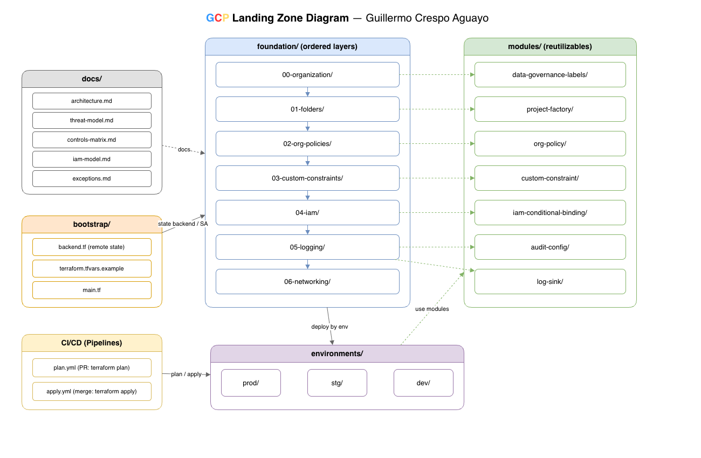

# GCP Landing Zone - Enterprise Banking & Clinical Data Platform

Landing Zone de nivel empresarial construida en Terraform para entidades altamente reguladas (Banca y Datos Clínicos/Salud), con cumplimiento de estándares **PCI-DSS**, **HIPAA**, **GDPR** e **ISO 27001**.

El diseño prioriza la **gobernanza organizacional preventiva**, **perímetros de seguridad (VPC Service Controls)**, **cifrado CMEK con rotación automática**, segregación estricta de dominios y el principio de **mínimo privilegio (Least Privilege IAM)** auditado con expresiones CEL.



---

## 🏛️ Estructura del Repositorio

```text
gcp-landing-zone/
├── README.md
├── docs/
│   ├── architecture.md
│   ├── ai-governance.md
│   ├── threat-model.md
│   ├── controls-matrix.md
│   ├── compliance-mapping.md
│   ├── iam-model.md
│   └── exceptions.md
├── bootstrap/
│   ├── backend.tf
│   ├── terraform.tfvars.example
│   └── main.tf
├── foundation/
│   ├── 00-organization/
│   ├── 01-folders/
│   ├── 02-org-policies/
│   ├── 03-custom-constraints/
│   ├── 04-iam/
│   ├── 05-logging/
│   ├── 06-networking/
│   └── 07-ai-governance/
├── modules/
│   ├── org-policy/
│   ├── custom-constraint/
│   ├── iam-conditional-binding/
│   ├── audit-config/
│   ├── log-sink/
│   ├── project-factory/
│   ├── data-governance-labels/
│   └── vpc-sc-perimeter/
├── environments/
│   ├── dev/
│   ├── stg/
│   └── prod/
│
├── cloudbuild.yaml (Todo en uno)
├── cloudbuild-apply.yaml (Para push a main)
├── cloudbuild-plan.yaml  (Para pull request)
└── .github/ (GitHub Actions)
    └── workflows/
        ├── plan.yml
        └── apply.yml
```

---

## 📚 Referencias Oficiales y Comparativa de Diseño

Este diseño toma como punto de partida y extiende las directrices oficiales de Google Cloud:
*   **[Google Cloud Landing Zone Design Guide](https://cloud.google.com/architecture/landing-zones)**: Principios de diseño para gobernanza, seguridad, redes y escalabilidad en Google Cloud.
*   **[Google Cloud Enterprise Foundations Blueprint](https://cloud.google.com/architecture/foundations)** (`terraform-example-foundation`): Arquitectura de referencia modular en fases para organizaciones empresariales reguladas.

### ⚖️ Matriz Comparativa: Enterprise Foundations Blueprint vs. Este Diseño

| Dominio Arquitectónico | Enterprise Foundations Blueprint (Google Cloud) | Decisiones Propias en esta Landing Zone | Justificación de Negocio / Valor Agregado |
| :--- | :--- | :--- | :--- |
| **Gobernanza de IA & Agentes** | No cubierta de forma nativa (enfoque tradicional en GKE/Compute/Cloud SQL). | **Fase 07 (`07-ai-governance`) y Custom Constraints CEL (`agent_platform_*`)**. Plantilla securizada con CMEK en Vertex AI, Vector Search, Artifact Registry y Notebooks. | Mitiga riesgos emergentes de IA (exfiltración de prompts, modelos desprotegidos, endpoints públicos) bajo NIST AI RMF e ISO 42001. |
| **Control de Identidades & IAM** | Asignación estática de roles a grupos de Google Workspace. | **RBAC granular con expresiones CEL en `foundation/04-iam`**. Restricción de acceso legal y científico a ventana laboral UTC y limitación de impersonación solo a cuentas `sa-agent-*`. | Aplica mínimo privilegio estricto (Least Privilege) y Segregación de Responsabilidades (SoD) para auditoría e inferencia sin riesgo de escalada de privilegios. |
| **Cuentas de Servicio por Workload** | Cuentas de servicio genéricas por capa aplicativa o proyecto. | **Identidades desacopladas por ciclo de vida de IA**: `sa-agent-training`, `sa-agent-serving`, `sa-agent-vector-search`. | Limita el radio de impacto (*blast radius*) impidiendo que un compromiso en inferencia/serving afecte a los datos maestros de entrenamiento o índices vectoriales. |
| **VPC Service Controls** | Perímetro único transversal o gestión estática de perímetros. | **Ciclo de vida multi-entorno parametrizado con `modules/vpc-sc-perimeter`**: `dev` en Dry-Run explícito (`use_explicit_dry_run_spec`), `stg` en validación pre-prod y `prod` en Enforced estricto con todas las APIs soportadas. | Balancea la seguridad absoluta en producción contra la agilidad y velocidad del desarrollador en entornos de experimentación e integración. |
| **Gobernanza Preventiva de Datos** | Políticas organizacionales estándar predefinidas. | **Custom Constraints CEL v2** para forzar CMEK en BigQuery y Vertex AI, junto con el módulo `modules/data-governance-labels` para inyección obligatoria de clasificación de datos (`confidential-pci-hipaa`). | Garantiza trazabilidad y catalogación automatizada para cumplimiento de PCI-DSS v4.0, HIPAA y GDPR. |
| **Residencia y Soberanía de Datos** | Sin restricción geográfica obligatoria por defecto. | **Restricción estricta `gcp.resourceLocations` limitada a `in:eu-locations`** en todas las fases y entornos. | Cumplimiento regulatorio del GDPR y el Reglamento de Inteligencia Artificial de la UE (EU AI Act). |
| **Seguridad Transversal & Auditoría** | Cloud Logging sink genérico hacia BigQuery/GCS. | **Seguridad integral de 3 capas**: SCC a nivel org con alertas streaming a Pub/Sub y mute configs en dev; Access Transparency / Access Approval obligatorios; e ingestión inmutable de auditoría con retención bloqueada a 7 años (2555 días). | Garantiza trazabilidad ante auditorías forenses externas y supervisión de accesos de soporte de Google a datos regulados. |

---

## 🛡️ Aspectos Clave de Seguridad y Políticas Organizativas

### 1. Control de Acceso Condicional (CEL) - Departamento Legal
- **Roles:** `roles/bigquery.dataViewer` y `roles/cloudsql.viewer`.
- **Restricción:** Solo lectura e inspección de esquemas y datos en producción; sin permisos de exportación, creación de copias o modificación.
- **Condición CEL:** Acceso condicionado exclusivamente a ventana laboral (`request.time.getHours('UTC') >= 8 && request.time.getHours('UTC') <= 18`).
- **Trazabilidad:** Registro exhaustivo de `DATA_READ` y `DATA_WRITE` en todas las consultas en BigQuery y Cloud SQL.

### 2. Políticas Organizacionales Preventivas (Guardrails)
- **`compute.vmExternalIpAccess` (Deny All):** Prohíbe que cualquier máquina virtual tenga IP pública.
- **`compute.skipDefaultNetworkCreation`:** Evita la creación de redes por defecto `default`.
- **`iam.disableServiceAccountKeyCreation`:** Elimina el riesgo de fuga de llaves JSON estáticas de cuentas de servicio.
- **`sql.restrictPublicIp`:** Fuerza que las bases de datos transaccionales residan exclusivamente en redes privadas.
- **`gcp.resourceLocations`:** Restringe el despliegue de recursos exclusivamente a regiones de la Unión Europea para cumplimiento de residencia de datos.

### 3. Custom Constraints (Reglas CEL Avanzadas)
- **`custom.requireBigQueryCmek`:** Bloquea la creación o actualización de cualquier dataset de BigQuery que no esté cifrado con una clave gestionada por el cliente (CMEK en Cloud KMS).
- **`custom.storagePreventPublicAccess`:** Deniega la creación de buckets de almacenamiento sin acceso uniforme a nivel de bucket (`uniformBucketLevelAccess`).

### 4. Perímetros de Seguridad y Diferenciación de Entornos (VPC Service Controls)
- **Desarrollo (`environments/dev`):** Perímetro en modo **Dry-Run** (`use_explicit_dry_run_spec = true`), registrando violaciones en Cloud Logging para análisis sin bloquear la agilidad y las pruebas de los desarrolladores.
- **Staging (`environments/stg`):** Entorno pre-productivo con CMEK dedicado y perímetro VPC-SC (`sp_stg_data_shield`) para validación de paridad e integración antes del pase a producción.
- **Producción (`environments/prod`):** Perímetro estrictamente **Enforced** (`status`) que encapsula los proyectos regulados de Banca Core y Plataforma Clínica con bloqueo total ante intentos de exfiltración de datos.
- **Servicios restringidos:** `BigQuery`, `Cloud Storage`, `Cloud SQL Admin`, `Cloud KMS`, `Secret Manager`, `Vertex AI`.
- **Políticas de ingreso:** Excepciones controladas basadas en niveles de acceso de red corporativa autorizada (`Access Context Manager`).

### 5. Seguridad Transversal: Security Command Center (SCC) y Access Transparency
- **Security Command Center:** Notificaciones en streaming a Pub/Sub para hallazgos activos con severidad `HIGH` y `CRITICAL`, junto con reglas de silenciamiento (`mute configs`) para control de ruido en entornos de desarrollo.
- **Access Approval y Access Transparency:** Control y aprobación obligatoria ante accesos administrativos por parte de personal de Google Cloud, con captura inmutable de trazas en el log sink centralizado de BigQuery.

### 6. Auditoría Inmutable
- Exportación agregada a nivel de organización de todos los registros de auditoría administrativa y de acceso a datos hacia un dataset dedicado en BigQuery con retención de 2555 días (7 años).

---

## ☁️ Secuencia de Despliegue en CI/CD

1. **`bootstrap/`**: Inicializa buckets de estado cifrados con CMEK y Workload Identity Federation (WIF).
2. **`foundation/00-organization/`**: Configura contactos esenciales y notificaciones de seguridad.
3. **`foundation/01-folders/`**: Despliega la jerarquía aislada de carpetas para segregación de dominios.
4. **`foundation/02-org-policies/`**: Aplica guardrails y restricciones preventivas organizacionales.
5. **`foundation/03-custom-constraints/`**: Despliega reglas CEL para forzar CMEK y almacenamiento privado.
6. **`foundation/04-iam/`**: Configura RBAC con condiciones CEL por horario y mínimo privilegio.
7. **`foundation/05-logging/`**: Activa el sink centralizado de auditoría y los registros `DATA_READ`/`DATA_WRITE`.
8. **`foundation/06-networking/`**: Despliega la Shared VPC Hub, subredes segregadas, Cloud NAT, Private Service Connect y perímetro VPC-SC.
9. **`foundation/07-ai-governance/`**: Despliega el proyecto plantilla de IA con CMEK en Cloud KMS, bucket seguro de datos, Artifact Registry, Tensorboard, Endpoint gobernado e inscripción en VPC-SC.
10. **`environments/dev/`**: Aprovisiona cargas de desarrollo con perímetro VPC-SC en modo Dry-Run.
11. **`environments/stg/`**: Despliega el entorno de staging con CMEK y validación pre-productiva.
12. **`environments/prod/`**: Aprovisiona proyectos de producción altamente regulados bajo perímetro VPC-SC Enforced y CMEK inmutable.
